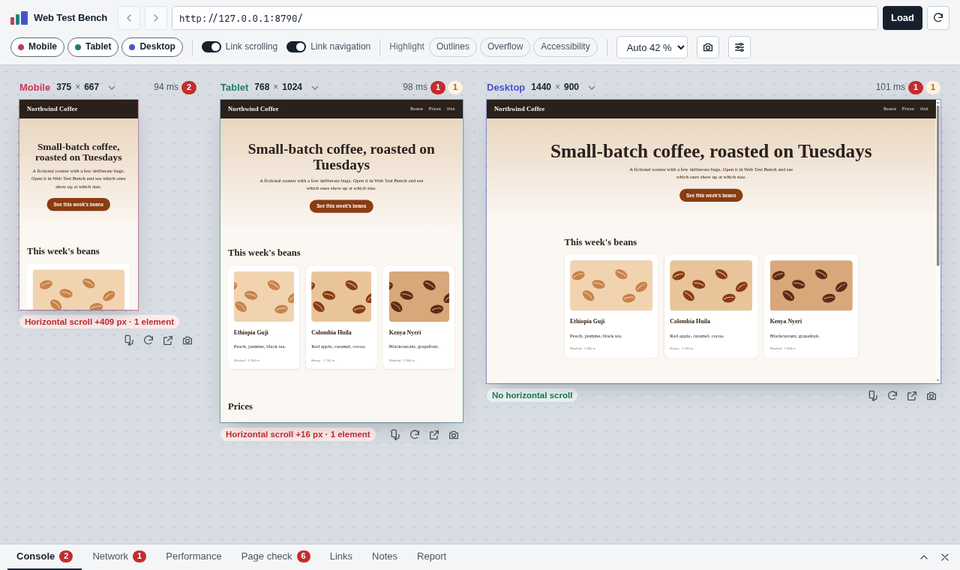

<div align="center">


# Web Test Bench

**Test a web page as a phone, a tablet and a desktop at once, and get one report of everything that is wrong.**

A Chrome extension for manual testing, with a terminal report that AI agents and CI can read.

[](https://github.com/petrzpav/web-test-bench/actions/workflows/smoke.yml)
[](LICENSE)
[](https://developer.chrome.com/docs/extensions/develop/migrate/what-is-mv3)
[](#language)
[](#for-ai-agents-and-ci)
[](https://github.com/petrzpav/web-test-bench/stargazers)

[Quick start](#quick-start) •
[Features](#features) •
[For AI agents and CI](#for-ai-agents-and-ci) •
[FAQ](#faq)



</div>

## Why

DevTools shows one screen size at a time, and the console, the network and the performance data only for that one. Checking a page at three sizes means resizing, reloading and opening DevTools three times.

Web Test Bench puts the three sizes side by side, keeps them on the same content as you scroll and click, and collects all their errors, warnings, requests and measurements in one panel, each marked with the size where it happened.

## Features

📱 **Three sizes side by side**
- Pick a device or type any size. You can rotate, hide or reorder the frames.
- Frames keep their real CSS width and are only scaled for display, so media queries and `innerWidth` behave as on the device.

🔗 **Linked scrolling and navigation**
- Frames line up by content, not by percentage, even when the page is three times longer on a phone.
- A link clicked in one frame opens in all of them, and Back and Forward work across them.

🐞 **Console and network**
- Errors, warnings, exceptions, failed resources and requests, deduplicated, each marked with the sizes where it happened.

⚡ **Performance per size**
- TTFB, FCP, LCP, CLS, load time, request count and transferred bytes, rated by the Core Web Vitals thresholds.

🔍 **Page check per size**
- Horizontal overflow, with the exact elements that cause it.
- Tiny tap targets and text, oversized and broken images, missing `alt`, form fields without labels, duplicate ids, mixed content.
- Title, description, H1, `lang`, viewport, robots, canonical, Open Graph, favicon.

🧭 **Links, checklist and notes**
- A link checker, a manual-testing checklist and notes, kept per site.

🤖 **Built for AI agents**
- The same data as a Markdown or JSON report, from a tab, a JavaScript API or a terminal command.
- Includes a [Claude Code skill](#claude-code-skill).

<p align="center"></p>

## Quick start

1. Clone this repository, or download it as a ZIP and unpack it.
2. Open `chrome://extensions` and turn on **Developer mode**.
3. Click **Load unpacked** and select the repository folder.
4. On any page, click the extension icon or press <kbd>Alt</kbd>+<kbd>Shift</kbd>+<kbd>T</kbd>.

The bench opens in a new tab with that page. Local dev servers work too: `localhost:5173`, `127.0.0.1:8000`, `*.test`.

### Try it on the demo page

[`demo/`](demo) is a small made-up coffee shop page with deliberate bugs:

- a price table that overflows on phones,
- a script error only on narrow screens,
- a missing script,
- an image without `alt`,
- tiny tap targets.

```sh
python3 -m http.server 8000 --directory demo
# then open http://localhost:8000 in the bench
```

## Keyboard and controls

| Action | How |
|---|---|
| Focus the address bar | <kbd>/</kbd> |
| Reload all frames | <kbd>R</kbd> |
| Show or hide a frame | <kbd>1</kbd> <kbd>2</kbd> <kbd>3</kbd>, or click its label at the top |
| Reorder frames | drag a label at the top, or <kbd>Alt</kbd>+<kbd>←</kbd> / <kbd>→</kbd> |
| Minimise the results panel | <kbd>D</kbd>; the × button hides it in a corner button that still counts errors |
| Change a frame's size | edit the numbers next to its name, or pick a device from the arrow |

## For AI agents and CI

An AI agent should not need screenshots at three sizes or a DevTools session to know whether a page works. `tools/wtb.mjs` runs the bench in headless Chromium and prints the full report.

```sh
npm install                          # once: playwright-core
npx playwright install chromium      # once, if you have no Chromium

node tools/wtb.mjs https://example.com             # Markdown report
node tools/wtb.mjs https://example.com --json      # the same as JSON
node tools/wtb.mjs localhost:8000 --links --shots ./shots
```

<details>
<summary><b>All options and exit codes</b></summary>

| Option | What it does |
|---|---|
| `--json` | print JSON instead of Markdown |
| `--links` | also check every link on the page |
| `--shots <dir>` | save a full-page PNG for each size |
| `--sizes 390x844,820x1180,1920x1080` | other sizes for mobile, tablet and desktop |
| `--timeout <s>` | how long to wait for the measurement (default 45) |
| `--lang en\|cs` | report language (default: from `LANG`) |
| `--chrome <path>` | the Chromium binary (or `WTB_CHROME`) |

| Exit code | Meaning |
|---|---|
| `0` | no serious finding |
| `1` | a serious finding (`✗`), such as a console error, a failed request, horizontal overflow or a page that did not load; or the measurement did not finish |
| `2` | the tool itself failed |

The CLI needs **Chromium**: Google Chrome 137 and newer ignores `--load-extension`.

</details>

What the report says about the demo page (shortened):

```markdown
## Key findings

- ✗ Console: 2 errors, e.g. `Failed to load <script> http://127.0.0.1:8790/analytics.js`
- ⚠ Console: 1 warning, e.g. `Newsletter widget: API key missing, using demo mode`
- ✗ Network: 1 failed request, e.g. 404 `http://127.0.0.1:8790/analytics.js`
- ✗ Mobile 375 px: horizontal scroll +409 px, caused by `#prices > table.prices “Coffee250 g500 g1 kgSubscription …” (760 px wide, overflows by 409 px)`
- ✗ Tablet 768 px: horizontal scroll +16 px, caused by `#prices > table.prices …`
- ⚠ Mobile: small tap targets 3×, tiny text 3×, images without alt 1×, form fields without a label 1×, …

## Console (3)

- Error `Uncaught TypeError: Cannot read properties of undefined (reading 'toggle')` — Mobile, `http://127.0.0.1:8790/:79:67`
```

The JSON report contains:

- `passed`, `ready` and `findings` (`{ severity: "bad" | "warn", text }`),
- `viewports.<mobile|tablet|desktop>` with `perf`, `ratings`, `horizontalOverflowPx` and `issues.<key>.items[]`, where each item has a CSS selector `path`,
- `console`, `failedRequests`, `links` and `page`.

<details>
<summary><b>Example: run it in GitHub Actions</b></summary>

```yaml
- name: Test the page at three sizes
  run: |
    git clone --depth 1 https://github.com/petrzpav/web-test-bench /tmp/wtb
    npm ci --prefix /tmp/wtb
    npx --prefix /tmp/wtb playwright install --with-deps chromium
    node /tmp/wtb/tools/wtb.mjs http://localhost:3000 --lang en
```

The step fails when the report has a serious finding.

</details>

### Claude Code skill

[`skill/`](skill) contains the `web-test-bench` skill. With it, Claude Code tests a page by itself when you ask it to check a site or after it changes a frontend, and it knows how to read the report.

```sh
ln -s "$PWD/skill" ~/.claude/skills/web-test-bench
```

### JavaScript API

In the bench tab, for scripts and browser-driving agents:

```js
webTestBench.load('https://example.com');
await webTestBench.waitUntilReady();          // true when all frames are measured
webTestBench.report();                        // JSON
webTestBench.reportMarkdown();                // Markdown
await webTestBench.checkLinks('internal');    // 'all' | 'internal' | 'external'
webTestBench.setSize('mobile', 390, 844);
webTestBench.setVisible('tablet', false);
webTestBench.highlight('mobile', ref);        // flash an element from issues.<key>.items[n].ref
```

## Language

The interface and the reports are in **English** and **Czech**.

- **Extension:** follows the browser language. Change it under **Settings → Language**.
- **CLI:** follows `LANG`, or use `--lang en` / `--lang cs`.

## FAQ

<details>
<summary><b>How is this different from the DevTools device mode?</b></summary>

The device mode shows one size at a time. Here you see three at once, and their console, network, performance and layout problems are collected and compared per size, so a bug that only happens on a phone stands out. The device mode still emulates things the bench does not: the server-side User-Agent, the pixel density and touch events.

</details>

<details>
<summary><b>Why does it need access to all sites?</b></summary>

To show any site in its frames and measure it. The extension removes `X-Frame-Options` and `Content-Security-Policy` from responses, but only for frames inside the bench tab and only while the bench is open. Everything stays in your browser: there is no server and no analytics.

</details>

<details>
<summary><b>Do logins work?</b></summary>

Mostly. The server gets your cookies, so you stay logged in. The page's own JavaScript only sees `SameSite=None` cookies, because the page runs as embedded content. A cookie banner may therefore keep coming back.

</details>

<details>
<summary><b>How accurate are the timings?</b></summary>

The timings are indicative. All three frames load at once and share the network. The bench subtracts the browser's queueing where it can measure it, and it rates a frame by a faster frame that measured the same thing. **Performance → Measure again** reloads a single frame for cleaner numbers.

</details>

<details>
<summary><b>What else is different from a real device?</b></summary>

- Service workers are disabled in the frames, so reloads always hit the network.
- CSP violations are not reported, because CSP is removed so that any site can be framed.

</details>

## Contributing

Issues and pull requests are welcome. The extension is plain JavaScript with no build step: edit the files, then click the reload button on `chrome://extensions`.

- `dashboard.*` is the bench page.
- `content/probe.js` runs inside each frame.
- `tools/wtb.mjs` is the CLI.

`npm test` runs `tools/smoke.mjs`, and `npm run pack` builds the Chrome Web Store ZIP in `dist/`. It tests the demo page and a clean page in both languages and checks that every frame was measured. CI runs it on every push.

## Privacy

No server, no analytics, nothing leaves your browser. See [PRIVACY.md](PRIVACY.md).

## License

[MIT](LICENSE) © Pavel Petržela
