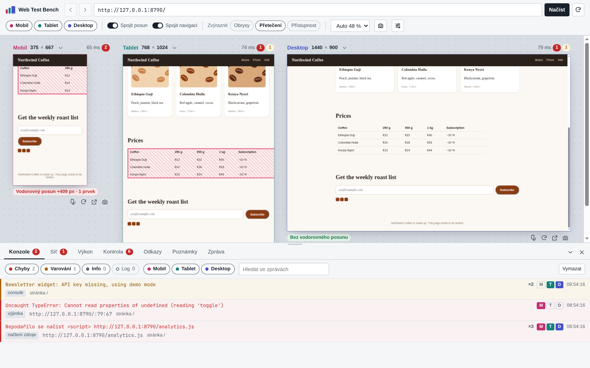
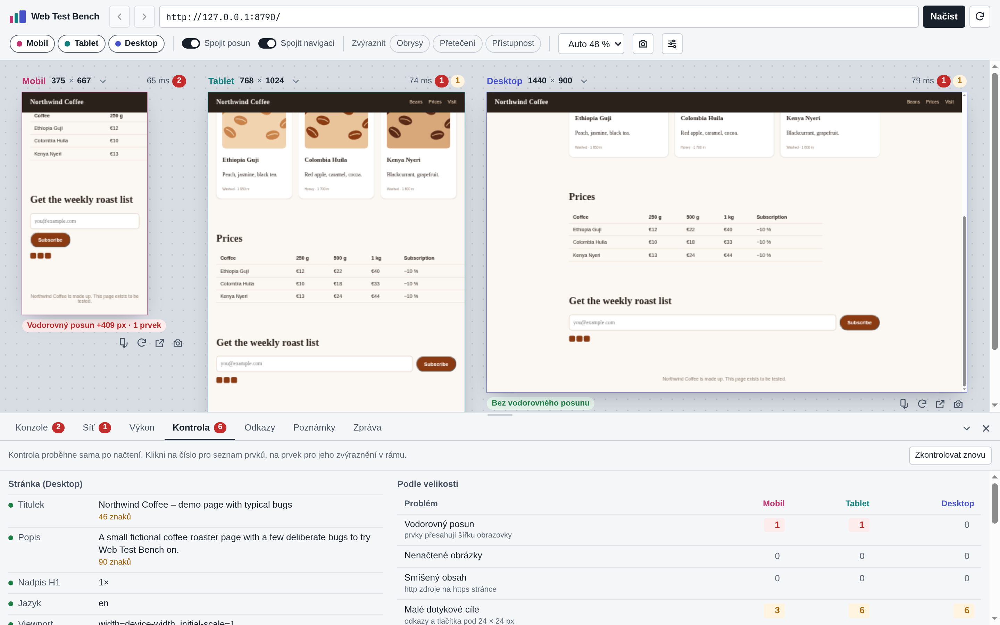

# Web Test Bench

A Chrome extension for testing a web page by hand at three screen sizes at once. It also has a terminal report that an AI agent or a CI job can read instead of taking screenshots.



Open any page and Web Test Bench shows it as a phone, a tablet and a desktop side by side. Scrolling and clicking in one frame moves the others to the same content. A bar at the bottom collects everything a tester would otherwise dig out of DevTools, per screen size:

- console errors and warnings,
- failed requests,
- load speed,
- layout problems,
- accessibility gaps,
- SEO basics,
- broken links.

> The interface and the reports are in Czech for now.

## Features

- **Three sizes side by side.**
  - Pick a device or type any width and height. You can rotate a frame, hide it, or drag the labels at the top to reorder the frames.
  - Frames keep the real CSS width and are only scaled down for display, so media queries and `innerWidth` behave as on the device.
  - Phones and tablets get overlay scrollbars, like the real thing.
- **Linked scrolling by content.**
  - Every frame shows the same element at the same place, even when the page is three times longer on a phone.
  - The frame you touched last leads. The others never jitter back while you scroll.
  - If the content comes in a different order at another width, the other frames wait and catch up when you stop.
- **Linked navigation.** A link you click in one frame opens in all of them. Back and Forward work across the frames.
- **Console**: errors, warnings, uncaught exceptions and failed resource loads, deduplicated, each marked with the sizes where it happened.
- **Network**: failed and slow requests, grouped and filterable.
- **Performance per size**: TTFB, FCP, LCP, CLS, DOMContentLoaded, load, request count and transferred bytes, rated by the Core Web Vitals thresholds.
- **Page check**, per size:
  - horizontal overflow, with the exact elements that cause it,
  - tap targets under 24 × 24 px and text under 12 px,
  - oversized and broken images, images without `alt`, form fields without labels, links and buttons without text,
  - duplicate ids and mixed content.
- **Page metadata**: title and description length, H1, `lang`, viewport, robots, canonical, Open Graph, favicon.
- **Highlights in the page** for element outlines, overflowing elements and accessibility problems.
- **Link checker** for internal, external or all links.
- **Checklist and notes per site**, kept between sessions.
- **Report** as Markdown or JSON, ready to paste into an issue or hand to an AI.
- **Debug-bar style dock**: minimise it to its tabs (`D`) or hide it in a corner button that still shows the error count.
- **Screenshots** of one frame or of the whole bench.



## Install

1. Clone or download this repository.
2. Open `chrome://extensions` and turn on **Developer mode**.
3. Click **Load unpacked** and select the repository folder.
4. On any page, click the extension icon or press **Alt+Shift+T**. The bench opens in a new tab with that page.

You can also open the bench empty and type an address. Local dev servers work: `localhost:5173`, `127.0.0.1:8000` and `*.test`.

### Try it on the demo page

`demo/` holds a small fictional page with a few deliberate bugs:

- a price table that overflows on phones,
- a script error that only happens on narrow screens,
- a missing script,
- an image without `alt`,
- tiny tap targets.

```sh
python3 -m http.server 8000 --directory demo
```

Then open `http://localhost:8000/` in the bench.

## Controls

| Action | How |
|---|---|
| Focus the address bar, reload | `/`, `R` |
| Show or hide a frame | click the Mobil / Tablet / Desktop label at the top, or `1`–`3` |
| Reorder frames | drag a label at the top, or Alt+← / Alt+→ on a label |
| Change a frame's size | edit the numbers next to its name, or pick a device from the arrow next to them |
| Zoom | the menu at the top right; **Auto** fits all frames to the window |
| Minimise or hide the dock | `D` or the arrow minimises it to its tabs; × hides it in the corner button |

## For AI agents and CI

An AI agent does not need screenshots or DevTools to check a page. `tools/wtb.mjs` loads the extension in headless Chromium, opens the bench and prints the full report.

```sh
npm install                                     # once, installs playwright-core
npx playwright install chromium                 # once, if you have no Chromium yet
node tools/wtb.mjs https://example.com          # Markdown report
node tools/wtb.mjs https://example.com --json   # the same data as JSON
node tools/wtb.mjs localhost:8000 --links --shots ./shots
```

| Option | What it does |
|---|---|
| `--json` | print JSON instead of Markdown |
| `--links` | also check every link on the page |
| `--shots <dir>` | save a full-page PNG for each size |
| `--sizes 390x844,820x1180,1920x1080` | other sizes for mobile, tablet and desktop |
| `--timeout <s>` | how long to wait for the measurement (default 45) |
| `--chrome <path>` | the Chromium binary to use (or `WTB_CHROME`) |

Exit codes:

- `0`: no serious finding.
- `1`: a serious finding (`✗`), for example a console error, a failed request, horizontal overflow or a page that did not load. Also returned when the measurement did not finish.
- `2`: the tool itself failed.

The command needs **Chromium**: Google Chrome 137 and newer ignores `--load-extension`. It looks in `~/.cache/ms-playwright` and then in `/usr/bin/chromium`.

This is what the report says about the demo page (shortened):

```text
## Hlavní zjištění

- ✗ Konzole: 2 chyby, např. `Nepodařilo se načíst <script> http://127.0.0.1:8790/analytics.js`
- ⚠ Konzole: 1 varování, např. `Newsletter widget: API key missing, using demo mode`
- ✗ Síť: 1 neúspěšný požadavek, např. 404 `http://127.0.0.1:8790/analytics.js`
- ✗ Mobil 375 px: vodorovný posun +409 px, způsobuje `#prices > table.prices „Coffee250 g500 g1 kgSubscription …“ (760 px široký, přesah 409 px)`
- ⚠ Mobil: malé dotykové cíle 3×, drobný text 3×, obrázky bez alt 1×, pole formuláře bez popisku 1×, …

## Konzole (3)

- Chyba `Uncaught TypeError: Cannot read properties of undefined (reading 'toggle')` — Mobil, `http://127.0.0.1:8790/:79:67`
```

The JSON has English keys:

- `passed`, `ready` and `findings` (`{ severity: "bad" | "warn", text }`),
- `viewports.<mobile|tablet|desktop>` with `perf`, `ratings`, `horizontalOverflowPx` and `issues.<key>.items[]`, where each item has a CSS selector `path`,
- `console`, `failedRequests`, `links` and `page`.

### Claude Code skill

`skill/` contains the `web-test-bench` skill. With it, Claude Code runs the bench by itself when it should test a page or check a frontend change, and it knows how to read the report. To install it for all your projects:

```sh
ln -s "$PWD/skill" ~/.claude/skills/web-test-bench
```

### JavaScript API in the bench tab

```js
webTestBench.load('https://example.com');
await webTestBench.waitUntilReady();          // true when all frames are measured
webTestBench.report();                        // JSON
webTestBench.reportMarkdown();                // Markdown
await webTestBench.checkLinks('internal');    // 'all' | 'internal' | 'external'
webTestBench.setSize('mobile', 390, 844);
webTestBench.setVisible('tablet', false);
webTestBench.highlight('mobile', ref);        // highlight an element from issues.<key>.items[n].ref
```

The ready state is also in `document.body.dataset.wtReady`.

## How it works and its limits

- **Framing.** To frame any site, the extension removes `X-Frame-Options` and `Content-Security-Policy` from sub-frame responses. A session rule does this only in the bench tab and only while the bench is open. CSP violations are therefore not reported.
- **What is emulated.** The frames emulate width and height, so breakpoints and layout are tested. They do not change the User-Agent sent to the server, the device pixel ratio or touch events. An option can report a mobile User-Agent to the page's JavaScript.
- **Cookies.** The page runs as embedded content. The server gets all cookies, so logins work, but the page's JavaScript only sees `SameSite=None` cookies.
- **Service workers** are disabled in the frames so that reloads always hit the network.
- **Timings.** All frames load at once and share the network. Timings are indicative: the browser's queueing between the frames is subtracted where it can be measured. **Výkon → Změřit znovu** reloads a single frame for cleaner numbers.

## License

[MIT](LICENSE)
